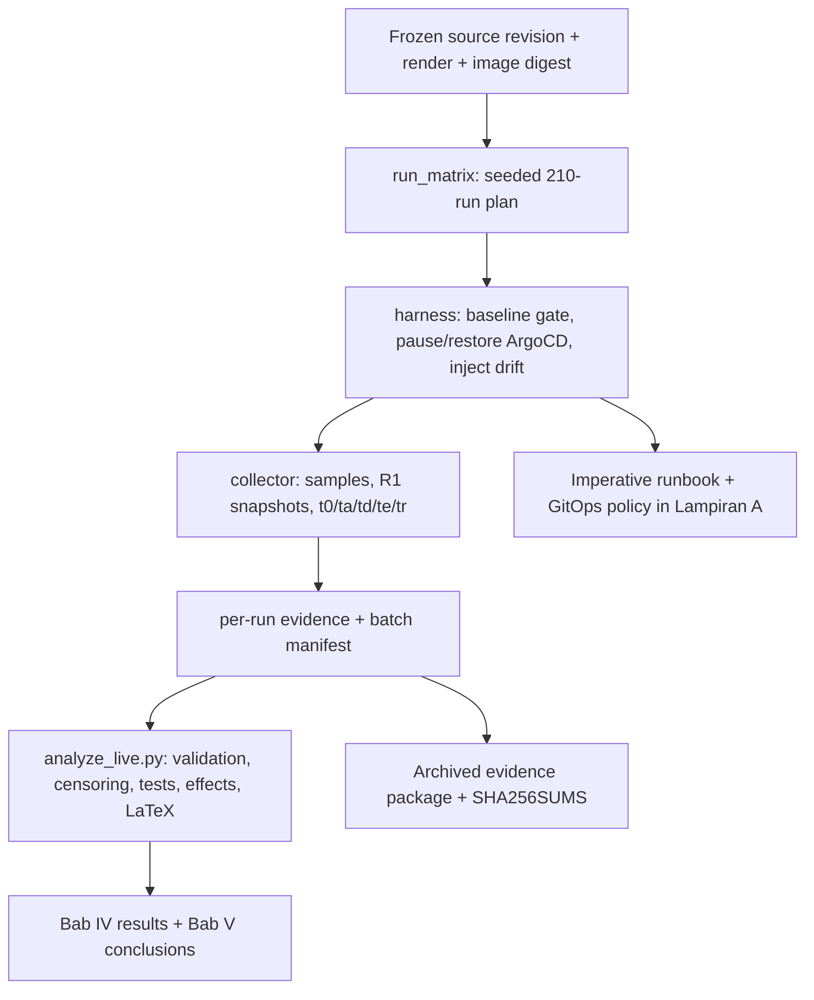
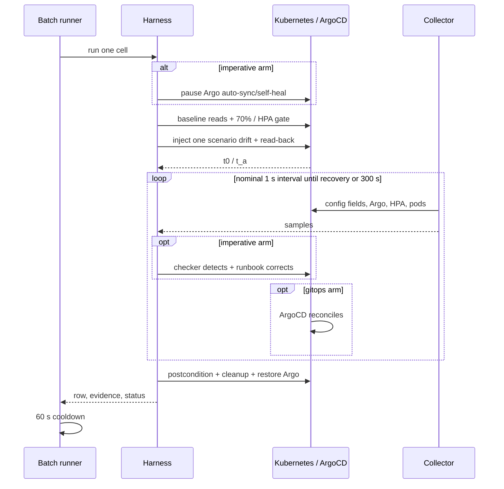

# Reproducibility and examiner evidence dossier

Status: formal batch `formal-20261029` completed on 2026-10-30; primary analysis
frozen and reproduced identically on 2026-11-19. No new live run is approved.
This dossier is the index for the question “show me the runbook, the script, the
raw evidence, and how to repeat it.” It is not the results chapter.

Current-state companions:

- [`../../experiments/REVISIONS.md`](../../experiments/REVISIONS.md) — frozen tags and post-freeze code status.
- [`../../experiments/DATA.md`](../../experiments/DATA.md) — dataset inventory, exclusions, hashes, privacy, reproduction commands.
- [`../../experiments/ARCHITECTURE.md`](../../experiments/ARCHITECTURE.md) — module map, data flow, state machine, trust boundaries.
- [`formal-20261029-results.md`](formal-20261029-results.md) — observed results and interpretation boundaries.
- [`claim-traceability.md`](claim-traceability.md) — every numerical claim to its output, code, test, and raw evidence.
- [`verification-2026-11-19.md`](verification-2026-11-19.md) — verification commands and evidence.

## 1. Current formal batch — completed

| Item | Value |
|---|---|
| Batch ID | `formal-20261029` |
| Design | 2 arms × 7 scenarios × 15 reps = 210 cells; reps 1–10 R2, 11–15 R1 |
| Mode | live, one production-like InvenioRDM stack, sequential arms |
| Terminal / pending cells | 210 / 0 |
| Raw rows | 211 (one pre-injection baseline retry) |
| Analysis rows | 207 (192 observed, 15 right-censored) |
| Exclusions | 4 (2 instrumentation, 1 retried baseline, 1 batch stop) |
| Frozen collection revision | `3572f3c1c11d3abc8b63882c4348b1b803d4256f` |
| GitOps revision | `81ddd259780e0e6aef333811a0126f86d70a094e` |
| Render SHA-256 | `a5efd711d661438590a730291c41b70d1c668b2672d51a54f68c0ff68e311703` |
| Seed / arm order / scenario order | `20261029` / `gitops, imperative` / `E, A, G, D, C, F, B` |
| Timing convention | `completed-observation-v1` |
| Primary analysis outputs | `experiments/analysis-formal-20261029/` (local, gitignored; 7 files) |
| Batch integrity | 3,024 files verified by `SHA256SUMS`; `PROVENANCE.json` committed |
| Analysis identity | 7 files verified; re-run with `--seed 20261029` is identical |

The manifest records `state: "stopped"` because three runs retain a
`stop_reason`; completeness is `counts.terminal = 210` and `counts.pending = 0`.
See [`../../experiments/DATA.md`](../../experiments/DATA.md) for the exact
mapping.

## 2. Historical stopped batches — archive, not a launch packet

| Item | Value |
|---|---|
| Batch ID | `formal-20261027c` |
| Design | 2 arms × 7 scenarios × 15 reps = 210 runs; reps 1–10 R2, 11–15 R1 |
| Mode | live, one production-like InvenioRDM stack, sequential arms |
| Batch command | `experiments/live/run_matrix.py` with `--live --confirm-single-stack --production-like` |
| Cooldown / retry | `--cooldown-seconds 60 --baseline-retries 1`; only pre-injection baseline failures retry |
| Seed | `20261027` |
| Recorded source revision | `7a49b8abcee3e10b3aaccc59c698b882a5d59ae4`; not a new freeze |
| Supplied render SHA-256 | `00c9d86a736fda246d2cf27c6b65757de51914983a0be09b5de07106ecf603b4`; contents were not independently verified by the old harness |
| Image digest | `sha256:14de27fa5637c66fe5fec97edd9a7d0e17acb5bcb9e2b4bd5fb4467a42a5b41e` |
| Live output (temporary) | `/private/var/folders/nk/spb82z6d59g6fd9sl18zz_9r0000gn/T/opencode/formal-20261027c` |
| Historical progress watcher | `.../formal-20261027c/watch.sh`; not evidence of current supervision |
| Terminal/pending cells | 60 observed, 9 right-censored, 1 baseline-failed, 140 pending; 76 attempt rows; GitOps never started |
| Durable local copy | `experiments/evidence-local/stopped-batches-20261029/formal-20261027c/`; 1,040 source/copy SHA-256-verified files |

The stopped batch wrote a manifest around each attempt. Its final baseline
retry failed the unchanged 70% memory gate. Earlier partial attempts remain
excluded; both were independently located and copied on 2026-10-29T06:27Z:

| Batch | Original directory under approved temporary root | Durable copy under `experiments/evidence-local/stopped-batches-20261029/` | Integrity |
|---|---|---|---|
| `formal-20261027` | `formal-runs-20261027/` | `formal-20261027/` | 368 files, 2,150,212 bytes; every source/copy SHA-256 matched |
| `formal-20261027b` | `formal-runs-20261027b/` | `formal-20261027b/` | 74 files, 446,047 bytes; every source/copy SHA-256 matched |

Their manifests report 25 observed/1 baseline failure/184 pending and 4 observed/
1 baseline failure/205 pending respectively. These historical labels do not
certify measurement validity. Sibling `*-copy-integrity.json` files preserve
the exact inventory, source identity and counts. All three originals remain
intact; none of these local copies is a publication-screened or off-site backup.

Installed Gitleaks automated pattern screening of this three-batch local parent
completed with zero findings; safe tool/version/coverage report is
`experiments/evidence-local/stopped-batch-secret-pattern-screen-20261029.json`.
No matched values were retained or printed. This is not a privacy review or
publication certification; manual sensitive-content review remains open.
No partial, pilot or synthetic data is pooled into the next comparison.

### Apparatus state before the formal batch (historical)

This subsection records the pre-formal apparatus state on 2026-10-29. It is
historical context for the stopped batches, not a description of the completed
`formal-20261029` run.

Probe packaging #196, image pin #198 and activation #197 are deployed. GitOps main
subsequently reached `13eb25867f18008ca47e0d248223a2a19a3b826b` through the
separately approved suspended S3 deployment #204, then docs-only #206
(`9fbf8d4`); no backup schedule is active. #206 synchronized current storage,
hook, source-seed and backup-status descriptions; all six PR checks passed.
Shared image:
`sha256:52645b7b3804fca0178d4428994372356669569dd31b560f096615fdf343a357`.
This differs from the stopped apparatus; freeze the future source/render/image
independently after instrument/method approval. Do not reuse the table's old hash.

The six-hour background window ending 29 October 04:23:34 UTC showed lower worker
CPU/probe cost, two web/two worker replicas and no app restarts. It did not prove
loaded task progress or sustained compliance with the exact node gate. Redis
vocabularies backlog remained 264,140; weekly-failure and stale-backup alerts fired.
Keep HPA/resources and 70% unchanged. Queue/recovery/capacity and method gates
remain; R3 is unmeasured, off-site copy deferred. See the current completion
roadmap and GitOps `ACTIVE-PLAN-AUDIT.md` for dispositions and approval boundaries.

Raw post-rollout evidence: `experiments/evidence-local/post-probe-acceptance-20261029T042334Z/`.
Original investigation/rollout: `experiments/evidence-local/idle-memory-20261028/`.
Both are local archives, not independently stored disaster-recovery copies.

### Offline instrument and method evidence — 2026-10-29

| Delivery | Identity / evidence | Boundary |
|---|---|---|
| Exact node accounting, bounded baseline and retry identity | Thesis #18, `19ca71a`;172 tests and PR/main CI passed | No changed timing estimand or freshness threshold |
| Frozen scoped R1 oracle | Thesis #20, `f747606`;206 tests; PR CI40828610184/main CI40828846218 passed | Four selected resources, not whole-cluster consistency |
| Independent source candidate | GitOps `87c3b5a`,27 objects/four targets; bundle SHA-256 `a5eed56174ebfc51c529339247e9c39f9964abdea53158b3ce46cdca406f61ac` | Preparation candidate, not final freeze |
| Lead oracle integration checks | `experiments/evidence-local/frozen-r1-integration-20261029/` | 210-cell zero-network dry-run,140 R2/70 R1, blank outcomes; safe archived field comparison4/4 |
| Timing audit | `experiments/evidence-local/timing-audit-20261029/` | Corrected read-only report, reproducible base sources and checksums; defects reproduced offline |
| Timing correction | Thesis #22, `ada7397`;274 independently passing tests; PR CI40838755692/main CI40839100521 passed | Completed-observation convention implemented; no revised live measurements collected |
| Seeded-recovery preparation | `experiments/evidence-local/seeded-recovery-preparation-20261029/` | Current source linkage and native backup metadata only; no restored seed/file proof |
| Operational S3 machinery and suspended deployment | GitOps #204, `13eb258`;254 tests/5existing skips; PR CI40849767229 and Deploy Verify40854677445 passed | Suspended CronJob, zero backup Jobs, three loaded rules healthy/inactive; no actual backup/restore proof |
| First operational file backup | One approved manual Job at12:13:49–12:13:56UTC; worker-02; exit0;1object/65,536bytes; snapshot `20261029T121353Z-4d0b1d71a53f` | Helper-verified copy and manifest; schedule still suspended; restore unproven |
| Node telemetry freshness gate | Thesis #24, `ef85c1a`;283 tests; PR CI40877391171 passed | 30s sample-end age /30s window enforced at readiness; future timestamps fatal; 70% gate unchanged |
| Stage 1 runtime readiness | `experiments/evidence-local/runtime-readiness-20261029/` | One sample: all six node/resource pairs under70% and within30s/30s; sustained window and queue progress remain UNPROVEN |

Owner selected one procedure with prespecified10 R2/5 R1 primary subsets,
independent four-resource declaration, completion-based timing from injection
dispatch, two timely matching observations for recovery, evaluation-completion
evidence and metric-level missingness at early recovery stop. Exact decisions
and approval boundaries are in `docs/plans/active/2026-10-29-next-gates.md`.
These decisions are not supervisor sign-off. Old/new timing conventions must
not be pooled. Oracle #20 alone did not repair timing defects merely by making
R1 expectations independent.

That timing implementation subsequently landed through #22, with separate
evaluation/store times, timely two-observation confirmation, eligible R1 samples,
cooperative read/retry stopping and per-metric missingness. Validation/report
artifacts: `experiments/evidence-local/timing-integration-20261029/`.
Legacy data remain unchanged and separately validated; the instrument now rejects
mixing them with `completed-observation-v1`. Supervisor/runtime freeze, freshness
and live-operation gates are still not satisfied by these offline checks.

Authenticated S3 preparation at07:49UTC confirmed1 completed source object of
65,536bytes, empty staging bucket, no incomplete multipart uploads/parts and no
configured versioning/lifecycle in either inspected source bucket. Only sanitized
aggregates were retained in
`experiments/evidence-local/operational-s3-backup-preparation-20261029/`;
credentials/private keys/object names were not emitted. No backup or restore
occurred. Owner chose a maintained daily30-day operational backup for completed
files and staging objects, with interrupted uploads restarted and off-site deferred;
Implementation and explicitly approved suspended deployment were subsequently
verified through #204. Review/deployment evidence and checksums are in
`experiments/evidence-local/operational-s3-backup-review-20261029/`. New destination/
credential provisioning, active runtime/capacity/metric-contract validation,
manual backup, activation, retention deletion and isolated recovery remain gated.
Parent GitOps #202/#139 remain open. The new read-only activation-preflight plan
also includes synchronization of the maintained runbooks and evidence indexes;
no thesis chapter or historical data is rewritten by that task.

## 3. Pipeline



The same harness produces both arms. The imperative arm is not a separate
deployment: ArgoCD auto-sync/self-heal is paused, a fixed checker/runbook acts
with `kubectl`, and the original Application spec is restored in `finally`.

### Per-run measurement sequence

One run injects **one** drift, measures it continuously, restores the baseline,
and only then starts the next run. The batch does not inject all scenarios and
measure them later.



Arms are sequential: the batch completes all 105 runs of the first arm, then all
105 of the second. Within an arm, the seven scenarios run in one frozen shuffled
order, with reps 1–10 for R2 and 11–15 for R1. The arm order is seeded and
recorded; both arms use the same scenario permutation. They never run in
parallel on the stack.

### Historical HPA saturation — not the current replica count

The historical web HPA sample was at 4/4; its memory metric was
`average working set / 512Mi request`, with an 80% target. The observed value is
about 106% (roughly 544Mi per pod), so the desired count is above the 4-replica
maximum; the condition is `ScalingLimited: TooManyReplicas`. CPU is about 0%
and user traffic was not established. Probe-dominated aggregate counts are not
proof that all traffic was probes. Warm memory exceeded the target under the
observed workload; this does not prove a leak or establish a request change.
Raising
`maxReplicas` would add pods and worsen node memory; changing the request or
node capacity now would alter the frozen apparatus. It is recorded as an
apparatus condition and a threat to validity, not silently “fixed” mid-batch.

### Cluster components (observed 2026-10-27)

| Layer | Running components |
|---|---|
| Nodes | 3 × RKE2 v1.32.6, 8 vCPU / ~8 GiB each; `server` is control-plane/etcd and is tainted `CriticalAddonsOnly`; `worker-01` and `worker-02` carry application workloads; no cluster autoscaler |
| Control plane | kube-apiserver, etcd, kube-scheduler, kube-controller-manager, Canal CNI, CoreDNS, kube-proxy, metrics-server/API |
| External path | Cloudflare Tunnel DaemonSet → Traefik → IngressRoutes `invenio-api` and `invenio-ui` → `invenio-web` Service:8000 |
| Application | `invenio-web` Deployment (4/4, HPA), `invenio-worker` Deployment (3/3, HPA), `invenio-scheduler` (1/1); all use image digest `sha256:14de27…` |
| Data plane | CloudNativePG `postgres-3` (1 instance, worker-02), Redis master, OpenSearch single node, MinIO object store; `invenio-data`/`invenio-archive` RWX PVCs |
| GitOps | ArgoCD app-of-apps (`apps`, `invenio-bootstrap`, database/redis/search/minio/monitoring/velero apps); app-of-apps source `github.com/vityasyyy/invenio-rdm-gitops`, `main` |
| Observability | Prometheus, Grafana, Alertmanager, Loki, Alloy, node-exporter; `KubeHPAMaxedOut` is an active capacity signal |
| Storage | `btd-nfs` default StorageClass (NFS CSI); single NFS failure domain; MinIO and Invenio PVCs share it; off-site copy deferred |
| Backups | Velero + Kopia node-agent; scheduled backups; independent off-site copy not implemented |

The HPA calculation is:

```text
current utilization = average web working set / 512Mi request
observed            = ~544Mi / 512Mi = ~106%
target              = 80%
desired replicas    = ceil(4 × 106 / 80) = ceil(5.3) = 6
maximum             = 4
result              = 4, condition ScalingLimited: TooManyReplicas
```

The HPA is scaling pods, not nodes. Adding replicas would add roughly
`2 × 544Mi` of web memory to workers already near the 70% gate. That is why the
maximum was not raised and why the 60-second cooldown was the chosen control.

## 4. Examiner request → artifact

| Examiner request | Artifact to show | Canonical location | Status |
|---|---|---|---|
| Runbook proof | Two-arm procedure, pause/restore order, checker/corrector behavior, failure handling | [`../../experiments/live/README.md`](../../experiments/live/README.md) §Prosedur dua lengan; [`../../experiments/LIVE-OBSERVER.md`](../../experiments/LIVE-OBSERVER.md); Lampiran A.1 | Written; protocol executed for `formal-20261029` |
| Script example | Batch planner, harness control loop, injection/recovery, analysis entry point | `experiments/live/run_matrix.py`, `harness.py`, `experiments/analysis/analyze_live.py`; Lampiran A.3 | Written; thesis appendix contains the redacted excerpts |
| Raw proof | Manifest, rows, per-run evidence, collector samples, command ledger | `experiments/formal-20261029/` (local, gitignored; `SHA256SUMS`, `PROVENANCE.json` committed); stopped-batch copies under `experiments/evidence-local/` | Complete for the formal batch; manual sensitive-content review still required |
| Reproduce it | Exact commands, pinned revision/render, seed, expected counts, output hashes | This dossier §1 and §6; [`../../experiments/DATA.md`](../../experiments/DATA.md); [`verification-2026-11-19.md`](verification-2026-11-19.md) | Written; analysis reproduced identically |
| Results | R1 equality and R2 times/censoring/tests/effects | `analyze_live.py` outputs; Bab IV; [`formal-20261029-results.md`](formal-20261029-results.md) | Complete |
| Scope limits | One stack, sequential arms, HPA ceiling, R3 not measured, off-site copy deferred | Bab III, Bab IV §R3, Bab V; this dossier §8 | Written and reflected in Bab IV/V |

## 5. Evidence inventory

The formal batch is `experiments/formal-20261029/` (local, gitignored). Its
committed provenance files are `SHA256SUMS` (3,024 entries) and
`PROVENANCE.json`. The frozen analysis is
`experiments/analysis-formal-20261029/` (local, gitignored; 7 files). The batch
output contains:

- `<batch>.manifest.json` — plan, seed, arm/scenario order, run statuses,
  attempts, cooldowns, revisions, render digest.
- `<batch>.rows.jsonl` — every attempt with batch metadata; failures preserved.
- `<batch>.analysis.jsonl` — one analyzable row per planned cell; `imperative`
  mapped to `manual`; failed/retried attempts not double-counted.
- `<batch>.csv` and `<batch>.summary.json` — analysis columns and R1/R2 counts.
- `<run_id>/` — `baseline.json`, `contract.json`, `samples.jsonl`,
  `injection.json`, `imperative.json`, `arm.json`, `cleanup.json`,
  `postcondition.json`, `commands.jsonl`, `diff-*.json`.
- `batch.log` — runner log; review before publication, never assume absence of
  token/Secret material merely from the intended logging design.

The analysis package contains `live_analysis.json` and six `.tex` tables. Its
SHA-256 manifest is `experiments/analysis-formal-20261029/SHA256SUMS`; the seven
hashes are repeated in [`../../experiments/DATA.md`](../../experiments/DATA.md).

Before sharing, review every artifact for Secret values. The harness is designed
to keep token/Secret material out of logs and evidence; the archive still needs
a manual redaction check.

## 6. Reproduction procedure — post-hoc, not execution authorization

### 6.1 Reproduce the frozen analysis

This is the current, post-hoc reproduction path; it needs no cluster access and
does not authorize a new live run.

1. Verify the batch and analysis checksums from
   [`../../experiments/DATA.md`](../../experiments/DATA.md).
2. Run the analyzer with both frozen inputs and the formal seed:

   ```bash
   python3 experiments/analysis/analyze_live.py \
     --in experiments/formal-20261029/formal-20261029.analysis.jsonl \
     --rows experiments/formal-20261029/formal-20261029.rows.jsonl \
     --out /tmp/formal-20261029-rerun \
     --bootstrap 2000 --seed 20261029 --alpha 0.05
   ```

3. Compare the seven outputs; only `SHA256SUMS` should differ because the
   analyzer does not write it.
4. Reproduce the C-r02 sensitivity with
   `python3 experiments/sensitivity/c_r02_sensitivity.py --out /tmp/c-r02-sensitivity.json`.
5. Run the offline suites: 502 core tests and 9 sensitivity tests.

### 6.2 If a new live batch is ever approved

No new live run is approved by this dossier. A future batch needs a new launch
packet, a new frozen apparatus identity, and all method/readiness gates reopened.
For that future batch:

1. Confirm the `btd` kubeconfig context, `kubectl get nodes`, and the Invenio API
   `/api/me` with a test token.
2. Verify ArgoCD `apps` and `invenio-bootstrap` are `Synced/Healthy` and both
   have automated sync/self-heal before the batch.
3. Run the **dry-run** first; it must produce 210 planned rows without cluster
   writes.
4. Set `INVENIO_TOKEN` only in the environment; never in argv, logs, or the
   manuscript.
5. Run the separately approved, frozen launch-packet command into a **new**
   output directory and batch ID. Do not reuse a partial directory. Both live
   entrypoints require `--render-file`: hash the exact parsed bundle bytes,
   independently verify generation from immutable source, and retain provenance.
6. Use tested visible supervision and failure/completion notification; a detached
   process or a watch script alone is insufficient. Stop on non-retryable failure
   and preserve evidence; no silent resume or protocol change.
7. After the batch is terminal, verify 210 terminal cells, 105 per arm, 15 per
   scenario per arm, intended 10/5 R2/R1 allocation and at most one analysis row
   per analyzable cell; document every excluded cell and attempt.
8. Run the analyzer with both `analysis.jsonl` and `rows.jsonl`; record the seed,
   bootstrap, and alpha actually used.
9. Archive the evidence directory, generate `SHA256SUMS`, and record the archive
   location and hash in Lampiran A.

## 7. Manuscript mapping

| Manuscript part | What it must contain | Current state |
|---|---|---|
| Bab III | Implemented design, arms, scenarios, gates, timing, analysis family, and R3 limitation | Complete; aligned with the completed collection |
| Bab IV | Provenance, R1 tables, R2 survival/tests/effects, exclusions, separate A/F/G | Complete; numbers match [`formal-20261029-results.md`](formal-20261029-results.md) |
| Bab V | Bounded conclusions, threats, future work, R3 not measured, off-site deferred | Complete |
| Lampiran A | Runbook, script excerpts, evidence schema/sample, checksums, reproduction commands | Complete |
| Abstract | Bounded findings only, with the observed counts | Complete; R1 and R2 claims match Bab IV |

## 8. What the experiment shows and does not show

The experiment produced, per scenario and arm: R1 equality of the declared field
contract, and R2 detection/evidence/recovery times with censoring. B–E are the
managed-drift efficacy set; A is an HPA control; F is a separately reported
declared Service `targetPort` drift; G is descriptive and not ArgoCD self-heal.
Tests and effect sizes are reported with the predeclared Holm family. The study
does not prove universal GitOps superiority, does not measure R3, and does not
establish off-site disaster recovery. The observed direction and effect sizes are
in [`formal-20261029-results.md`](formal-20261029-results.md).

## 9. Open documentation gaps

- Manual sensitive-content review of the raw batch and local evidence archives is
  still required before publication or external sharing.
- All three identified stopped formal batches are copied with verified SHA-256
  inventories and intact originals; smoke/pilot material remains outside those
  three inventories.
- Supervisor sign-off for the one-stack, R3-deferred scope remains an external
  approval, not an evidence gap.
- The frozen analysis package is local and gitignored; the seven hashes are
  recorded in [`../../experiments/DATA.md`](../../experiments/DATA.md), but the
  package itself needs a durable archive separate from the working checkout.
- Historical HPA saturation and stopped-batch observations remain separate from
  the completed `formal-20261029` results. The exact historical node
  working-set gate series is unavailable; do not substitute MemAvailable
  history.
