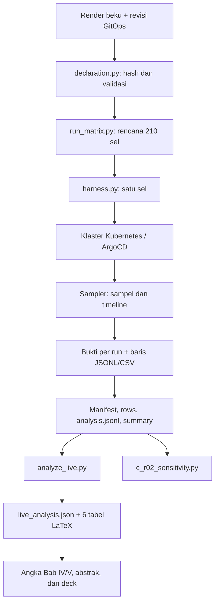
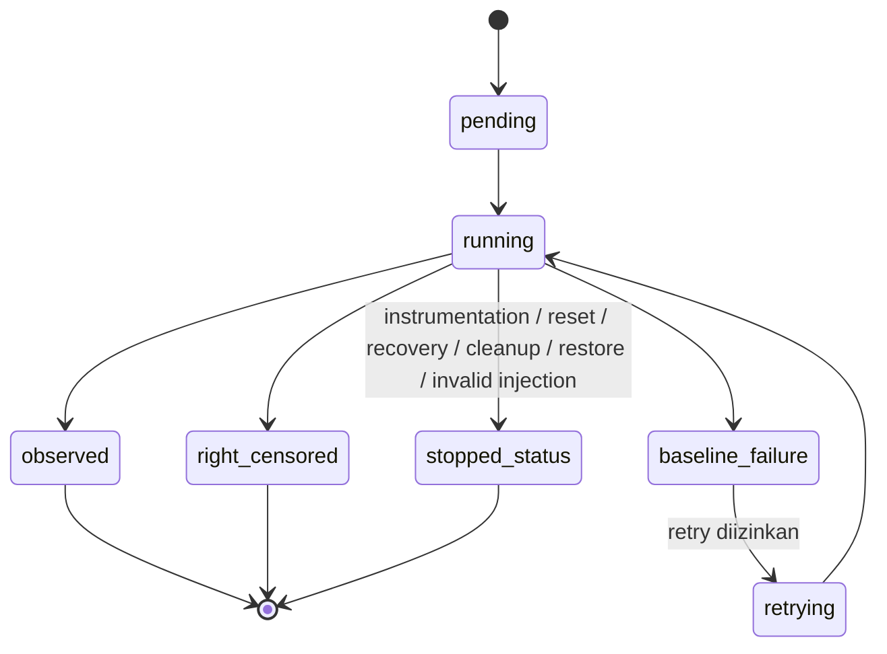

# Arsitektur apparatus dan aliran bukti

Dokumen ini memetakan modul, aliran data, transisi status, dan batas
kepercayaan apparatus eksperimen. Kontrak bukti terperinci ada di
[`live/README.md`](live/README.md) dan [`LIVE-OBSERVER.md`](LIVE-OBSERVER.md);
dokumen ini tidak mengubah skema atau perilaku.

## Peta modul

| Modul | Tanggung jawab | Entry point |
|---|---|---|
| [`live/harness.py`](live/harness.py) | Kontrol mode, snapshot, kontrak R1, baseline, injeksi, repair, sampler, timeline, baris, dan bukti per run | `main()`, `run_one.py` |
| [`live/run_matrix.py`](live/run_matrix.py) | Rencana 210 sel, manifest, resume, retry baseline, cooldown, ringkasan, dan baris analisis | `main()`, `run_batch()` |
| [`live/declaration.py`](live/declaration.py) | Loader render beku, hash byte, validasi revisi/identitas, dan pemilihan empat resource | `load()`, `loads()` |
| [`live/convert.py`](live/convert.py) | Jembatan JSONL ke kolom CSV historis | `row_to_csv()`, `write_csv()` |
| [`analysis/analyze_live.py`](analysis/analyze_live.py) | Validasi fail-closed, eksklusi, R1, survival, uji, efek, dan tabel LaTeX | `analyze()`, `main()` |
| [`analysis/summarize.py`](analysis/summarize.py) | Ringkasan deskriptif yang memisahkan sensor dan endpoint hilang | `summarize()` |
| [`sensitivity/c_r02_sensitivity.py`](sensitivity/c_r02_sensitivity.py) | Analisis sensitivitas satu baris C-r02 | `main()` |
| [`scripts/`](scripts/) | Validasi bukti offline; tidak menjalankan klaster | `*.sh`, `instruments.py` |
| [`tests/`](tests/) | 491 tes inti offline | `python3 -m unittest discover -s experiments/tests` |
| [`sensitivity/test_c_r02_sensitivity.py`](sensitivity/test_c_r02_sensitivity.py) | 8 tes sensitivity | `python3 -m unittest discover -s experiments/sensitivity` |

## Aliran data



Urutan koleksi per sel: baseline gate, injeksi satu drift, verifikasi perubahan,
sampling sampai pemulihan atau deadline, postcondition/reset, lalu restore mode.
`run_matrix.py` memanggil jalur `harness.main` yang sama dengan `run_one.py`,
sehingga gate token, satu stack, mode, reset, dan no-overwrite tetap berada di
satu tempat.

## Mesin status

### Status sel



Hanya `baseline_failure` pra-injeksi yang boleh di-retry, dan hanya bila tidak
ada `t0`, injeksi tidak diterima, cleanup `ok`, mode `restored`, serta tidak ada
mutasi. Kegagalan lain menghentikan batch dan mempertahankan bukti.

### Status batch

`run_batch()` menulis `state: running` selama ada sel yang diproses. Setelah
semua sel diproses:

- `state: complete` bila tidak ada run yang membawa `stop_reason`;
- `state: stopped` bila setidaknya satu run membawa `stop_reason`, dengan
  `stop_run_id` menunjuk kegagalan pertama.

Batch `formal-20261029` memuat tiga run dengan `stop_reason` (C-r01, C-r02,
G-r05), sehingga manifest tetap `stopped` meskipun `counts.terminal=210` dan
`counts.pending=0`. Kelengkapan koleksi dibaca dari hitungan, bukan dari
`state`; lihat [`DATA.md`](DATA.md).

## Batas kepercayaan

| Batas | Masukan | Validator | Kegagalan |
|---|---|---|---|
| Render beku | Berkas JSON lokal | `declaration.loads()`: hash byte, format `invenio-frozen-render-v1`, revisi 40 hex, identitas unik, namespace, bidang terpilih | Ditolak sebelum HTTP/aktivasi mode/injeksi; isi tidak dicetak |
| Token Invenio | `INVENIO_TOKEN` | `load_token()`; tidak pernah masuk argv/log/manifest/bukti | Run gagal sebelum mutasi |
| Pembacaan klaster | API Kubernetes/ArgoCD/metrics-server | `Snapshotter`, `parse_node_metrics()`, gate kesiapan 70%, umur sampel 30 detik, dua pembacaan cocok | Fail-closed: `InstrumentationError`, baseline tidak lulus |
| Baris mentah | `rows.jsonl` | `_classify_raw()`, `_validate_raw_chain()`, `_validate_analyzed_raw()` | Baris tidak layak dikecualikan dengan alasan; nilai tidak diimputasi |
| Baris analisis | `analysis.jsonl` | `validate_rows()`, `_validate_timing()`, `_validate_attempt_metadata()` | Input tidak valid ditolak; tidak ada keluaran sukses palsu |
| Keluaran analisis | JSON + tabel LaTeX | `write_outputs()` menolak menimpa tanpa `--force` | Berkas lama tidak tertimpa diam-diam |
| Klaim skripsi | Angka Bab IV/V/deck | [`docs/reproducibility/claim-traceability.md`](../docs/reproducibility/claim-traceability.md) | Klaim tanpa bukti ditandai, bukan dilengkapi dengan tebakan |

Prinsip umum: pembacaan yang gagal bukan nilai default; sensor bukan nol;
endpoint yang hilang bukan observasi tersensor; dan `SealedSecret` hanya
dibandingkan sebagai keberadaan/anotasi metadata.

## Kontrak pengukuran

- **Waktu.** Semua endpoint memakai `completed-observation-v1`: `t_d` adalah
  selesainya pembacaan/evaluasi sinyal pertama yang memenuhi jendela; `t_e`
  adalah selesainya evaluasi perbedaan bidang; `t_r` adalah selesainya
  observasi all-match pertama yang dikonfirmasi observasi berikutnya. Tidak ada
  clamp ke `t_a` dan tidak ada backdate dari sampel berikutnya.
- **Penyensoran.** `right_censored` hanya sah bila jendela benar-benar mencapai
  deadline. `unobserved_before_stop` bernilai `null` dan tidak masuk uji atau
  kurva survival.
- **R1.** Empat resource tetap: `Deployment/invenio-web`,
  `ConfigMap/invenio-app-config-<hash>`, `Service/invenio-web`, dan
  `SealedSecret/invenio-app-secrets`. R1 adalah persentase resource yang seluruh
  bidang terpilihnya cocok; `/spec/replicas` milik HPA dikecualikan.
- **F.** Skenario F adalah drift `targetPort` pada `Service/invenio-web` yang
  dideklarasikan. Label `visibility_boundary` di keluaran analyzer adalah kunci
  skema lama yang dipertahankan; arti prosa saat ini adalah drift Service yang
  dilaporkan terpisah dari keluarga efikasi B--E.
- **Populasi.** A = kontrol HPA, B--E = efikasi managed drift, F = drift Service
  terpisah, G = kasus deskriptif non-Argo. Tidak ada pooling A/F/G ke keluarga
  dua belas hipotesis.

## Bukti per run

Direktori `<run_id>/` menyimpan `baseline.json`, `readiness.json`,
`contract.json`, `samples.jsonl`, `sampler.json`, `injection.json`,
`imperative.json`, `arm.json`, `cleanup.json`, `postcondition.json`,
`commands.jsonl`, dan `diff-*.json`. Baris `<run_id>.jsonl` dan `<run_id>.csv`
menyimpan hasil analisis; `<batch_id>.rows.jsonl` menambahkan metadata batch,
attempt, dan stop reason. Checksum paket batch ada di
`experiments/formal-20261029/SHA256SUMS`.

## Verifikasi arsitektur

```bash
python3 -m unittest discover -s experiments/tests -q
python3 -m unittest discover -s experiments/sensitivity -p 'test_*.py' -q
bash -n experiments/scripts/*.sh
shellcheck experiments/scripts/*.sh
```

Tes offline tidak membuktikan klaster, seed, kapasitas, atau metode siap. Untuk
status koleksi dan reproduksi analisis, lihat [`REVISIONS.md`](REVISIONS.md) dan
[`DATA.md`](DATA.md).
