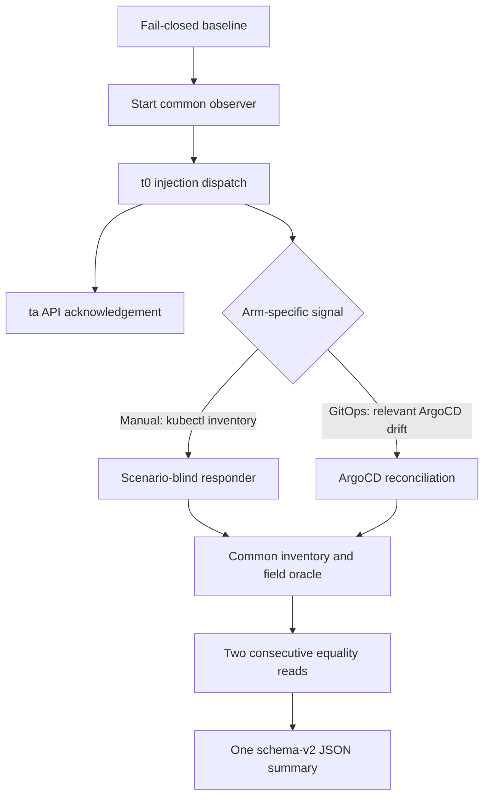

# Experiment apparatus

The scripts support controlled, single-injection measurements for the S1/S2
surrogate. This is experimental apparatus, not a production deployment tool.
The published data contract is [`schema-v2.md`](schema-v2.md). Schema-v2 analysis
must use the explicit JSON mode documented in `analysis/README.md`; the legacy
CSV path cannot interpret these records.



Instrumentation starts before injection, so `td` may precede `ta`. Manual
detection uses the imperative inventory signal; GitOps detection uses an actual
ArgoCD `OutOfSync`/`Missing` status for an expected resource. The common oracle
provides identical R1 and restoration checks to both arms, but does not replace
the GitOps detection signal. The responder receives only expected declarations
and observed differences; it never receives the scenario label or injection
metadata. Health is measured separately from desired-field equality.

## Offline use

The default command is a no-command, no-write preview:

```bash
python3 experiments/scripts/apparatus.py --subject s1 --env manual --scenario A
```

It writes no measurement, even when `--output` is supplied. Legacy shell entry
points are preview-only. `metrics-collect.sh --live-dryrun` remains available
only to append the old synthetic CSV example; that CSV and the checked-in
analysis outputs remain unchanged and are not schema-v2 measurements.

Run the offline regression and fake-client integration tests with:

```bash
PYTHONDONTWRITEBYTECODE=1 python3 -m unittest discover -s experiments/tests -v
```

Subprocess tests place explicit fake `kubectl`/`argocd` executables first (and
the adapter integration tests use a PATH containing only those fakes). No test
invokes an installed cluster client.

## Pilot gates and limitations

The runner accepts only `s1`/`s2`, one scenario `A`–`G`, a positive repetition
number, and the exact namespace mapped to the subject/environment. Live runs
must explicitly use `--live --phase pilot`, an allowlisted context in
`APPARATUS_PILOT_CONTEXTS`, and a passing baseline. GitOps runs additionally
require an exact `context|namespace|app` entry in
`APPARATUS_PILOT_TARGETS`; the ArgoCD application must report the selected
namespace and all expected resources. These allowlists are empty by default.
Formal execution is unsupported.

The live GitOps CLI path is deliberately blocked before any client command:
the field-level ArgoCD evidence transport has not been implemented and validated.
Status/health text is not substituted for deviation evidence. Offline adapters
can exercise that interface; unsupported evidence is explicitly not evaluable,
while independent detection/restoration observations are retained. This is an
offline-tested core, not a live-pilot-ready experiment pipeline.

Scenario F is fixture/reporting-only in this repair. It is an unmanaged
visibility-boundary case, not something the runner may create or clean up in a
derived namespace. Live F remains blocked pending separate boundary approval;
no namespace or arbitrary unmanaged resource is automatically deleted.

No live pilot or cluster readiness was validated. Fixture tests prove only
offline behavior. Before any separately approved pilot, validate the exact
Kubernetes/ArgoCD client versions, application-to-context mapping, expected
resource fields, API status behavior, metrics and pod readiness, and correction
semantics against the approved pilot context. The coordinator bounds every
client subprocess and records only sanitized identities/field paths; it never
stores Secret values, hashes, full manifests, raw diffs, or command stderr.

Before the next run, a separate approved reset must restore inventory and health.
This single-run tool does not automate batch allocation, randomization or cleanup.
A failed run remains recorded and the next baseline fails closed; no namespace
is deleted to make a subsequent run pass. Live F, the GitOps evidence transport,
context/app server mapping and formal-workload adapters remain future gates.
